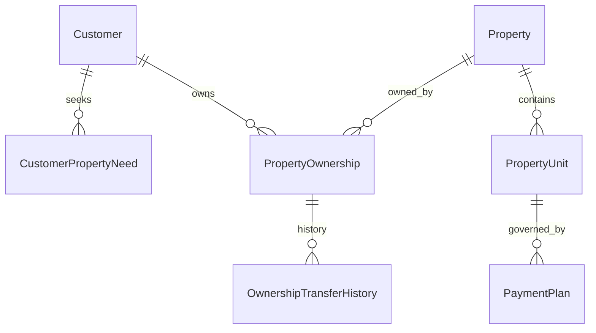
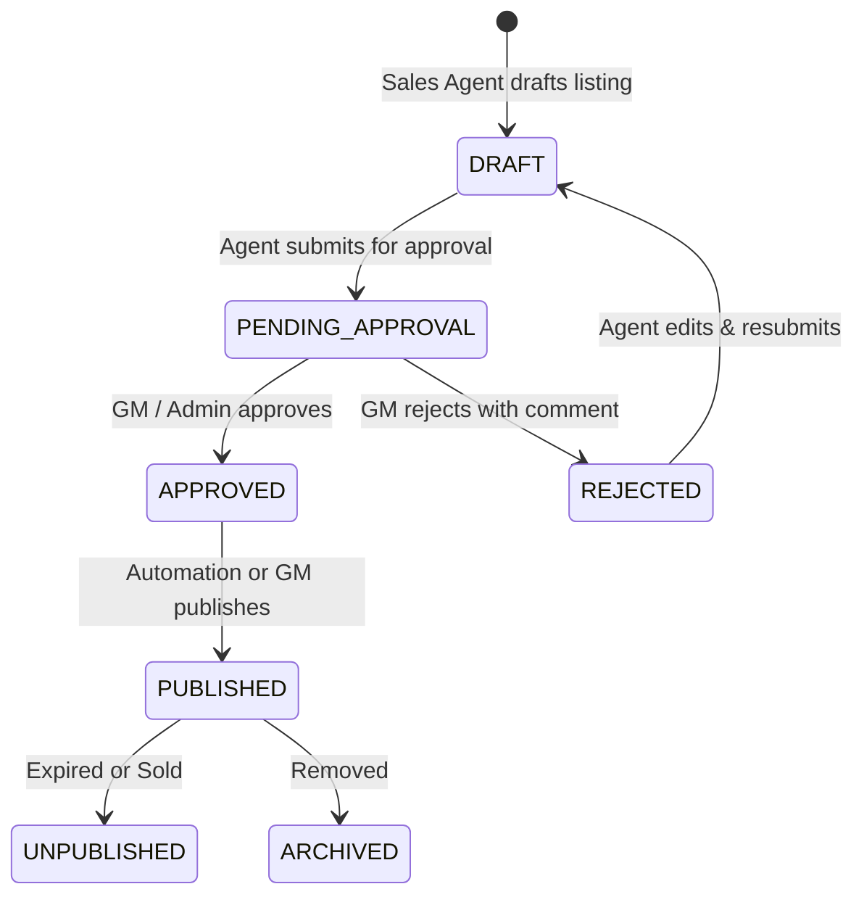

# Dark CRM — Future Data Architecture Specification

## 1. Executive Summary

This document defines the next-generation enterprise data architecture for **Dark CRM**, designed to scale to 500,000+ customers, millions of interactions, multi-unit ownership, comprehensive installment accounting, and an externally separated public listing catalog with multi-tier approval workflows.

---

## 2. Multi-Unit Ownership & Demand Decoupling

### 2.1 Current Limitation
In the legacy schema, `Customer` represents both a prospective buyer (lead) and has a loose relationship to properties via text fields or direct one-to-one relations. A customer cannot cleanly:
1. Own multiple distinct properties (e.g., an investor owning 5 villas across 3 compounds).
2. Have multiple concurrent property searches/needs with distinct budgets, locations, and assigned agents.
3. Track historical ownership transfers (resale from Customer A to Customer B).

### 2.2 Target Relational Model



### 2.3 Proposed Prisma Schema Definitions

```prisma
enum OwnershipType {
  PRIMARY_OWNER
  CO_OWNER
  INVESTOR
  POWER_OF_ATTORNEY
}

enum OwnershipStatus {
  ACTIVE
  TRANSFERRED
  DISPUTED
  ARCHIVED
}

model PropertyOwnership {
  id              String          @id @default(uuid())
  customerId      String
  customer        Customer        @relation(fields: [customerId], references: [id], onDelete: Restrict)
  propertyId      String
  property        Property        @relation(fields: [propertyId], references: [id], onDelete: Restrict)
  ownershipType   OwnershipType   @default(PRIMARY_OWNER)
  ownershipShare  Decimal         @default(100.00) @db.Decimal(5, 2) // e.g. 50.00%
  status          OwnershipStatus @default(ACTIVE)
  acquiredAt      DateTime        @default(now())
  contractNumber  String?
  notes           String?
  createdAt       DateTime        @default(now())
  updatedAt       DateTime        @updatedAt

  transfersFrom   OwnershipTransferHistory[] @relation("TransferFrom")
  transfersTo     OwnershipTransferHistory[] @relation("TransferTo")

  @@unique([customerId, propertyId, status])
  @@index([customerId])
  @@index([propertyId])
}

model OwnershipTransferHistory {
  id                String            @id @default(uuid())
  propertyId        String
  property          Property          @relation(fields: [propertyId], references: [id])
  fromOwnershipId   String?
  fromOwnership     PropertyOwnership? @relation("TransferFrom", fields: [fromOwnershipId], references: [id])
  toOwnershipId     String
  toOwnership       PropertyOwnership  @relation("TransferTo", fields: [toOwnershipId], references: [id])
  transferPrice     Decimal           @db.Decimal(15, 2)
  transferDate      DateTime          @default(now())
  dealId            String?
  deal              Deal?             @relation(fields: [dealId], references: [id])
  recordedById      String
  recordedBy        User              @relation(fields: [recordedById], references: [id])
  notes             String?

  @@index([propertyId])
  @@index([transferDate])
}

model CustomerPropertyNeed {
  id              String            @id @default(uuid())
  customerId      String
  customer        Customer          @relation(fields: [customerId], references: [id], onDelete: Cascade)
  assignedToId    String?
  assignedTo      User?             @relation(fields: [assignedToId], references: [id])
  targetTypes     PropertyType[]
  targetLocations String[]          // Preferred areas / compounds
  minBudget       Decimal?          @db.Decimal(15, 2)
  maxBudget       Decimal?          @db.Decimal(15, 2)
  minBedrooms     Int?
  maxBedrooms     Int?
  minAreaSqm      Decimal?          @db.Decimal(8, 2)
  urgency         NeedUrgency       @default(MEDIUM)
  status          NeedStatus        @default(ACTIVE)
  notes           String?
  createdAt       DateTime          @default(now())
  updatedAt       DateTime          @updatedAt

  @@index([customerId])
  @@index([assignedToId])
  @@index([status])
}

enum NeedUrgency {
  LOW
  MEDIUM
  HIGH
  IMMEDIATE
}

enum NeedStatus {
  ACTIVE
  FULFILLED
  CANCELLED
  EXPIRED
}
```

---

## 3. Comprehensive Payment Plans & Installment Tracking

### 3.1 Overview
Real estate sales in Egypt and the MENA region rely heavily on structured off-plan installment schedules extending over 3 to 10 years, featuring:
- Down payments and contract deposits.
- Quarterly or semi-annual regular installments.
- Annual balloon payments.
- Maintenance deposits (وديعه صيانة) usually payable 6 months prior to handover.
- Delivery payments (دفعة استلام).

### 3.2 Schema Architecture

```prisma
enum PlanStatus {
  DRAFT
  ACTIVE
  DEFAULTED
  COMPLETED
  CANCELLED
}

enum InstallmentType {
  DOWN_PAYMENT
  REGULAR
  BALLOON
  MAINTENANCE_FEE
  DELIVERY_PAYMENT
  REGISTRATION_FEE
  PENALTY
}

enum InstallmentStatus {
  UPCOMING
  DUE
  PARTIALLY_PAID
  PAID
  OVERDUE
  WAIVED
}

model PaymentPlan {
  id                  String               @id @default(uuid())
  dealId              String               @unique
  deal                Deal                 @relation(fields: [dealId], references: [id], onDelete: Restrict)
  totalUnitAmount     Decimal              @db.Decimal(15, 2)
  downPaymentAmount   Decimal              @db.Decimal(15, 2)
  maintenanceAmount   Decimal              @default(0) @db.Decimal(15, 2)
  numberOfInstallments Int
  frequencyMonths     Int                  @default(3) // 1=monthly, 3=quarterly, 6=semi-annual
  startDate           DateTime
  endDate             DateTime
  status              PlanStatus           @default(ACTIVE)
  gracePeriodDays     Int                  @default(14)
  lateFeePercentage   Decimal              @default(0) @db.Decimal(5, 2) // annual or per month
  createdById         String
  createdBy           User                 @relation(fields: [createdById], references: [id])
  createdAt           DateTime             @default(now())
  updatedAt           DateTime             @updatedAt

  installments        PaymentInstallment[]

  @@index([dealId])
  @@index([status])
}

model PaymentInstallment {
  id                  String             @id @default(uuid())
  planId              String
  plan                PaymentPlan        @relation(fields: [planId], references: [id], onDelete: Cascade)
  installmentNumber   Int
  type                InstallmentType    @default(REGULAR)
  dueDate             DateTime
  principalAmount     Decimal            @db.Decimal(15, 2)
  paidAmount          Decimal            @default(0) @db.Decimal(15, 2)
  remainingAmount     Decimal            @db.Decimal(15, 2)
  penaltyAmount       Decimal            @default(0) @db.Decimal(15, 2)
  status              InstallmentStatus  @default(UPCOMING)
  notes               String?
  createdAt           DateTime           @default(now())
  updatedAt           DateTime           @updatedAt

  payments            InstallmentPayment[]

  @@unique([planId, installmentNumber])
  @@index([planId])
  @@index([dueDate, status])
}

model InstallmentPayment {
  id                    String              @id @default(uuid())
  installmentId         String
  installment           PaymentInstallment  @relation(fields: [installmentId], references: [id], onDelete: Restrict)
  amountPaid            Decimal             @db.Decimal(15, 2)
  paymentMethod         PaymentMethod       @default(BANK_TRANSFER)
  paymentReference      String?             // Cheque number, bank wire ref, transaction ID
  receiptNumber         String              @unique
  collectedById         String
  collectedBy           User                @relation(fields: [collectedById], references: [id])
  paidAt                DateTime            @default(now())
  clearedAt             DateTime?
  financialTransactionId String?
  financialTransaction  FinancialTransaction? @relation(fields: [financialTransactionId], references: [id])
  notes                 String?

  @@index([installmentId])
  @@index([paidAt])
  @@index([receiptNumber])
}

enum PaymentMethod {
  CASH
  CHEQUE
  BANK_TRANSFER
  CREDIT_CARD
  ONLINE_GATEWAY
}
```

---

## 4. Public Catalog Separation & GM Approval Workflow

### 4.1 Business Driver
Internal properties often contain confidential seller contact information, acquisition margins, raw commission arrangements, or unpublished development files. Exposing internal property records directly to the web portal introduces massive data leakage hazards.

### 4.2 Architecture
Decouple `Property` (internal CRM inventory) from `PublicListing` (published website/portal catalog) using an asynchronous approval state machine.



### 4.3 Proposed Schema

```prisma
enum ListingApprovalStatus {
  DRAFT
  PENDING_APPROVAL
  APPROVED
  REJECTED
  PUBLISHED
  UNPUBLISHED
  ARCHIVED
}

model PublicListing {
  id                String                 @id @default(uuid())
  propertyId        String                 @unique
  property          Property               @relation(fields: [propertyId], references: [id], onDelete: Restrict)
  slug              String                 @unique
  publicTitleAr     String
  publicTitleEn     String
  publicDescriptionAr String
  publicDescriptionEn String
  publicPrice       Decimal                @db.Decimal(15, 2)
  currency          String                 @default("EGP")
  isPriceNegotiable Boolean                @default(false)
  
  // Public media sanitization (no raw watermarks or broker phone stamps)
  heroImage         String
  galleryImages     String[]
  floorPlanUrl      String?
  virtualTourUrl    String?
  videoUrl          String?

  featured          Boolean                @default(false)
  status            ListingApprovalStatus  @default(DRAFT)
  
  // Audit trail
  submittedById     String
  submittedBy       User                   @relation("SubmittedListings", fields: [submittedById], references: [id])
  submittedAt       DateTime?
  reviewedById      String?
  reviewedBy        User?                  @relation("ReviewedListings", fields: [reviewedById], references: [id])
  reviewedAt        DateTime?
  rejectionReason   String?
  publishedAt       DateTime?
  unpublishedAt     DateTime?
  viewCount         Int                    @default(0)
  inquiryCount      Int                    @default(0)

  createdAt         DateTime               @default(now())
  updatedAt         DateTime               @updatedAt

  @@index([status, publishedAt])
  @@index([slug])
}
```

---

## 5. Decimal Migration Strategy (Replacing Float)

### 5.1 The Danger of Floating-Point in Financial Calculations
Binary 64-bit IEEE 754 floating-point values (`Float` in Prisma / TypeScript numbers) cannot accurately represent base-10 fractional quantities like `0.10` or `0.05`.
- Example: `1000000.10 + 0.20 === 1000000.3000000001`.
- When calculating multi-stage commissions, sales taxes, and installment interest, cumulative rounding drift creates auditing discrepancies between CRM ledger balances and actual bank statements.

### 5.2 Affected Models & Target Fields

| Model | Field | Current Type | Target Type |
|---|---|---|---|
| `Property` | `price` | `Float` | `Decimal(15, 2)` |
| `Deal` | `dealValue` | `Float` | `Decimal(15, 2)` |
| `Deal` | `commission` | `Float` | `Decimal(15, 2)` |
| `Deal` | `commissionRate` | `Float` | `Decimal(5, 2)` |
| `Commission` | `amount` | `Float` | `Decimal(15, 2)` |
| `Commission` | `rate` | `Float` | `Decimal(5, 2)` |
| `FinancialTransaction` | `amount` | `Float` | `Decimal(15, 2)` |
| `Customer` | `budget` | `Float?` | `Decimal(15, 2)?` |

### 5.3 Zero-Downtime Neon Migration Procedure
To migrate from `Float` to `Decimal` on a live production Neon database without downtime or read/write lock freezes:

1. **Step 1 (Add Shadow Columns):**
   Add nullable decimal columns alongside existing float columns:
   ```sql
   ALTER TABLE "Deal" ADD COLUMN "dealValue_dec" DECIMAL(15, 2);
   ALTER TABLE "Deal" ADD COLUMN "commission_dec" DECIMAL(15, 2);
   ```

2. **Step 2 (Dual Write & Backfill):**
   - Update application Prisma model to populate both columns on write.
   - Run a batched background script to backfill data from old float columns to new decimal columns with `ROUND(CAST("dealValue" AS numeric), 2)`.

3. **Step 3 (Cutover Reads):**
   - Switch application reads to the new decimal columns (`dealValue_dec`).
   - Validate checksum sums across all financial entities.

4. **Step 4 (Rename & Clean Up):**
   ```sql
   BEGIN;
   ALTER TABLE "Deal" DROP COLUMN "dealValue";
   ALTER TABLE "Deal" RENAME COLUMN "dealValue_dec" TO "dealValue";
   ALTER TABLE "Deal" ALTER COLUMN "dealValue" SET NOT NULL;
   COMMIT;
   ```

---

## 6. Enterprise Scalability Checklist (100k - 500k Rows)

1. **Partitioning:**
   - Partition `AuditLog` and `Interaction` by year/month using PostgreSQL declarative range partitioning (`PARTITION BY RANGE (createdAt)`).
2. **Partial Indexes:**
   - Add partial index for active leads: `CREATE INDEX idx_customers_active_assigned ON "Customer"("assignedToId", "updatedAt") WHERE "status" NOT IN ('COMPLETED', 'ARCHIVED');`.
3. **Cursor-Based Pagination:**
   - Fully deprecate `offset / take` for large listings in favor of Keyset / Cursor pagination (`where: { createdAt: { lt: cursorDate } }`).
